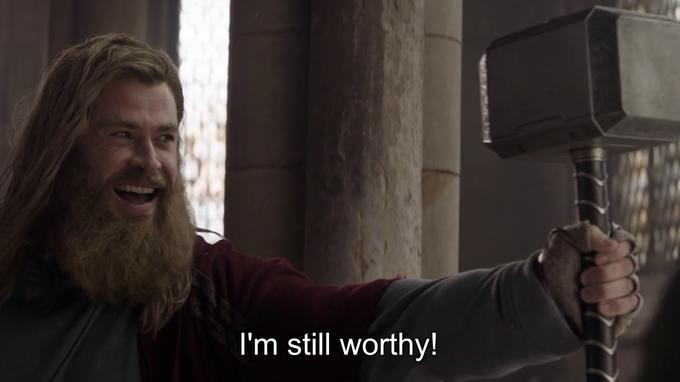

# I'm Still Worthy

Have I been one shotted by claude? Is codex taking my p(doom) to an all time high? Can I think for more than 30 seconds before asking gemini a question?

Yes, Yes, and no are the answers. But once across a time I wrote code by hand and had to trawl stack overflow. 

Goal here is to solve the mNist database with no AI code. I will be using codex to do my commits because git is a job for clankers. 

Update: I've managed to get above 98% with my 3 layer MATLAB. I've made a python copy for anyone who wants to use that (requires SciPy and a video of you saying "matrixes start at 1" to work)